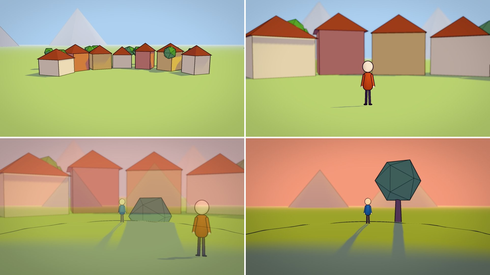
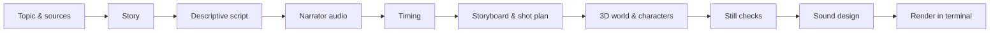

<div align="center">

# 🎬 Animated Story Skills

**Narrated animated story videos, from idea to MP4, built by an AI agent in code.**
No AI video generator. No downloaded assets. Works with any agent that reads `SKILL.md`.




<sub>Stills from the starter project's example: a procedural 3D world, 2D characters drawn in code, ink outlines,
depth of field, golden-hour light.</sub>

</div>

---

## Why this exists

People keep asking how an AI agent can make an animated video without an AI video generator. The answer: the agent
writes code that draws every frame. This repo packages the workflow behind two 16:9 educational videos (about 5 and 7
minutes long). It started from several well-known open-source skills, combined with what we learned in production.

- **Consistent characters.** Characters are drawn in code, so they look the same in every shot.
- **Full control.** Camera, light, timing and sound can be tuned down to the frame.
- **Free, open-source tools.** Remotion, three.js and Python, plus a free text-to-speech voice for the narrator.
- **One package.** Everything from shaping the story to the render command is here. No other skills needed.

## What's inside

| Skill | Stages | What it does |
|---|---|---|
| [`story-script`](skills/story-script/SKILL.md) | 1–4 | Shapes the story, writes it, applies script best practices, writes narration for a TTS voice, and walks you through generating the audio in Google AI Studio. Works on its own with any animation tool |
| [`animated-story`](skills/animated-story/SKILL.md) | 5–12 | The agent builds the video from the descriptive script and the narration: timing from the voice's pauses, storyboard, shot plan, 3D world, characters, still checks, sound design, test renders, and the final render command |

Also bundled:

- **A tested Remotion starter project** ([`assets/starter`](skills/animated-story/assets/starter)). It contains one
  complete example video with two sets, two light presets, a crossfade, a character, ink outlines, depth of field and
  a colour grade.
- **Look modules:** ink outlines, lens blur, colour grade, two-tone shading, character card shading, and the `Pen`
  drawing API.
- **Scripts:** script-to-audio alignment without a transcriber (`align_pauses.py`), synthesized SFX and instruments,
  low-res stills, contact sheets, and a frame-by-frame QA report.

## How it works



| # | Stage | Who | Output |
|---|---|---|---|
| 1 | Shape the story: material, premise, spine, structure | agent, you approve | premise + beat list |
| 2 | Write the story: scenes that turn, openings and endings | agent | script by chapter |
| 3 | Script best practices: narration for the ear + a picture for every paragraph | agent, you approve | `story/SCRIPT.md` (the descriptive script) |
| 4 | Narrator audio with TTS | **you** | `story/tts.wav` |
| 5 | Timing from the audio's pauses | agent | `narration.srt` |
| 6–9 | Storyboard, shot plan, 3D world, characters, still checks | agent, you review stills | video code + stills |
| 10–11 | Sound design, short test renders | agent | `mix.wav`, test clips |
| 12 | Final render | **you, in a terminal** | MP4 |

## Quick start

**1. Install the skills.** One command for supported agents:

```bash
npx skills add MogaTaufiq/animated-story-skills
```

Or copy the folders in `skills/` by hand:

| Agent | Skills folder |
|---|---|
| Claude Code | `~/.claude/skills/` (all projects) or `.claude/skills/` (one project) |
| Codex CLI, Gemini CLI, Copilot CLI | `~/.agents/skills/` or `.agents/skills/` |
| Claude.ai / Claude Desktop | zip each skill folder and upload it in the Skills menu |
| Agents without skill support | clone this repo; the agent reads [`AGENTS.md`](AGENTS.md) |

**2. Try the starter (optional, about 5 minutes).** Make sure rendering works on your machine:

```bash
cp -R skills/animated-story/assets/starter studio && cd studio
npm install
node scripts/stills.mjs out/s/x_ 30,240,318,450 0.5 Example
```

**3. Ask your agent for a video.** Open an empty folder in your agent and write something like:

> Use the animated-story skill. Topic: the origin of the hourglass. Sources: [file or link]. About 3 minutes,
> landscape, narrated in English.

The agent asks for a short brief, shapes the story and the script, and stops at every approval point.

## Recording the narrator (Google AI Studio)

1. Open [Google AI Studio: Generate Speech](https://aistudio.google.com/generate-speech?model=gemini-3.8-flash-tts)
   and sign in with a Google account.
2. Choose single-speaker mode. Under **Speaker**, pick a voice that suits your story. Listen to a few first and match
   the voice to your audience, genre and narration language.
3. Under **Style**, describe the delivery in one line. Our setting for a story with an evening mood:

   ```
   Speaker: Riko
   Style: Rich, velvety, unhurried audiobook narration setting an atmospheric evening scene
   ```

4. Test two or three sentences that contain the hardest names, and fix their spelling if needed.
5. Paste the narration from `story/NARRATION_TTS.txt` (without the `##` lines), run it, and listen to all of it.
6. Download the WAV and save it as `story/tts.wav`.

The full guide, with style lines for other moods and how to join chapters recorded separately:
[`tts-gemini-ai-studio.md`](skills/story-script/references/tts-gemini-ai-studio.md).

## Requirements

- A laptop or desktop with a GPU (3D renders through headless Chrome).
- Node.js 20+, Python 3 and [uv](https://docs.astral.sh/uv/) (numpy, scipy and Pillow are fetched when a script
  runs), and ffmpeg (or `npx remotion ffmpeg`).
- A Google account for free TTS in AI Studio, or any other TTS that exports WAV.
- Disk space: Remotion keeps a copy of the bundle in the temp folder on every render.

## Repository layout

```
skills/
  story-script/
    SKILL.md
    references/   story-craft.md · narration-for-tts.md · tts-gemini-ai-studio.md
  animated-story/
    SKILL.md
    references/   build-3d.md · sound.md
    scripts/      align_pauses.py · dsp.py · sfx_gen.py · instruments.py · short_qa.py
    assets/starter/   ready-to-run Remotion project (src/lib, src/videos/example, scripts)
docs/             images for this README
```

## Known limitations

This is v0.1. What we know so far:

- **Blinking assets.** Both test videos still have assets that blink throughout. We haven't found the cause yet, so
  the skills don't include anti-flicker rules.
- **Story quality.** The story rules in `story-script` come from the lessons of those two videos and haven't been
  re-tested on a new script yet.
- **Only tested in Claude Code.** Other agents support the format, but we haven't compared their results.
- **A simple starter.** The example has two sets and characters without walk cycles or expressions. A real video
  grows from there.
- **Timing for Latin-script languages.** `align_pauses.py` counts syllables with Indonesian rules. Other Latin-script
  languages come close; non-Latin scripts aren't supported yet.
- **The AI Studio guide** reflects the page as of November 2026. Menu names may change.
- **Slow renders.** A video several minutes long can take a while on a laptop.

## Roadmap

- [x] **v0.1**: two skills, a tested starter project, a TTS guide.
- [ ] **v0.2**: find the cause of the blinking and add anti-flicker rules; a full 60–90 second tutorial from script
      to MP4.
- [ ] **v0.3**: compare results with and without the skills, and across agents (Claude Code, Codex, Gemini CLI,
      Antigravity, and others).
- [ ] **v0.4**: animation style presets based on reference videos.

## References and credits

This repo grew out of exploring skills and tutorials that already existed. Thanks to:

| Reference | What we took |
|---|---|
| [mromidev/claude-animated-shorts](https://github.com/mromidev/claude-animated-shorts) (MIT) | The pipeline foundation, the short-form beat formula, the look modules, synthesized DSP and SFX, frame-by-frame QA |
| [jtydhr88/screenwriting-skills](https://github.com/jtydhr88/screenwriting-skills) (MIT) | Dramaturgy principles: premise, a value that turns in every scene, plant and payoff, openings and endings |
| [iart-ai/explainer-video-skills](https://github.com/iart-ai/explainer-video-skills) (MIT) | One sentence of narration = one picture; the script-to-screen flow |
| [iart-ai/javascript-animation-skills](https://github.com/iart-ai/javascript-animation-skills) (MIT) | How music should follow the picture |
| [iart-ai/motion-skills](https://github.com/iart-ai/motion-skills) | A map of motion-graphics skill packs |
| [jarmen423/skills](https://github.com/jarmen423/skills) (tts-script-writer) | Ideas for writing scripts for TTS (ideas only, no text copied) |
| [jwynia/agent-skills](https://github.com/jwynia/agent-skills) (document-to-narration) | Ideas for adapting written text for the ear (ideas only, no text copied) |
| Videos by [Mr omi](https://www.youtube.com/watch?v=OtbLL6OBNE4), [Nalarka](https://www.youtube.com/watch?v=C1Ul4viinEM), [Success With Sam](https://www.youtube.com/watch?v=8400Bkm214E) | Workflow ideas: voice-over first, measure instead of guessing, check stills first, agent teams split by file |

Which files were copied, and under which licence: [THIRD_PARTY.md](THIRD_PARTY.md).

## Contributing

Tried it? Open an issue and tell us which agent you used, what your video was about, and where you got stuck.
Results from agents other than Claude Code are especially useful for v0.3. If this repo helped you, a ⭐ helps
other people find it.

## License

[MIT](LICENSE). Third-party parts keep their own licences; see [THIRD_PARTY.md](THIRD_PARTY.md).
